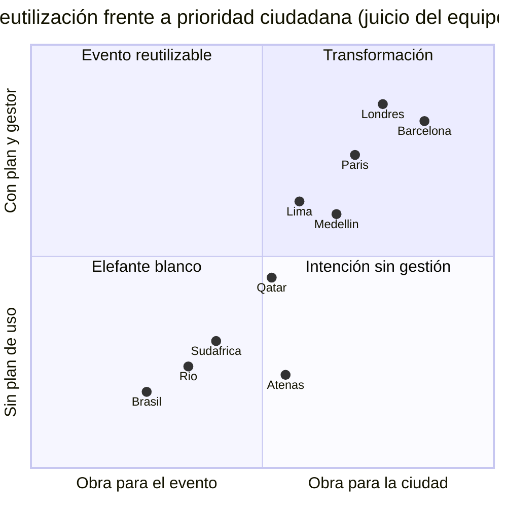

# Tabla comparativa de las ciudades

← [Índice](README.md)

## 1. Síntesis

| Ciudad y evento | Costo reportado (base propia, **no comparable**) | Sobrecosto deportivo real* | Qué quedó | Qué falló | Balance |
|---|---|---|---|---|---|
| **Barcelona** 1992 | US$ 8.012 M infraestructura + US$ 1.364 M organización | 266 % | Frente marítimo, rondas, saneamiento, hoteles | Presión sobre la vivienda | 🟢 |
| **Atenas** 2004 | € 8.500 M (organizadores) | 49 % | Aeropuerto, metro, tranvía | Escenarios abandonados | 🟠 |
| **Sudáfrica** 2010 | > US$ 3.000 M públicos | n. a. | Transporte y aeropuertos | Estadios subutilizados, beneficio desigual | 🟠 |
| **Medellín** 2010 | $ 193.865 M de pesos ejecutados | n. a. | Coliseos, vivienda en la villa | Afectación a venteros y uso libre | 🟢 |
| **Londres** 2012 | Paquete público £ 9.298 M (proyección de £ 528 M por debajo) | 76 % | Parque, barrio, transporte | Vivienda asequible bajo la meta | 🟢🟠 |
| **Brasil** 2014 | R$ 25.500 M | n. a. | Aeropuertos y algunos corredores | Estadios ociosos, movilidad inconclusa | 🔴 |
| **Río** 2016 | US$ 23.600 M deportivos (2022) | 352 % | Metro, puerto, BRT recuperado | Saneamiento, desalojos, deterioro | 🔴 |
| **Lima** 2019 | ~US$ 1.200 M | n. a. | Sedes, villa, reutilización para 2027 | Continuidad institucional | 🟢 |
| **Qatar** 2022 | US$ 200.000-220.000 M (década de obras) | n. a. | Metro, vías, estadio desmontable | Costo humano, dudas de uso | 🟠 |
| **París** 2024 | € 6.650 M de gasto público | 115 % (estimado) | Río, equipamientos | Costo social disputado, poco impacto en PIB | 🟢🟠 |

\* [Oxford Olympics Study 2024](https://arxiv.org/abs/2406.01714): solo Juegos Olímpicos; costos de operación y obras deportivas directas, **sin** transporte, aeropuertos ni hoteles. «n. a.» = no aplica o no hay medida equivalente. El estudio calcula un sobrecosto **promedio de 159 %** en términos reales y señala que **ningún** Juego estudiado cumplió su presupuesto. Fuentes de cada costo: ver las [fichas](02-casos/README.md).

## 2. Matriz por dimensión

Valoración **cualitativa del equipo** sobre la evidencia reunida. 🟢 legado favorable · 🟠 mixto · 🔴 desfavorable · ⚪ sin evidencia suficiente.

| Ciudad | Movilidad | Infraestructura y espacio público | Economía | Ambiente | Inclusión | Servicios públicos | Legado urbano |
|---|---|---|---|---|---|---|---|
| Barcelona | 🟢 | 🟢 | 🟢 | 🟢 | 🟠 | 🟢 | 🟢 |
| Atenas | 🟢 | 🔴 | 🔴 | ⚪ | ⚪ | ⚪ | 🟠 |
| Sudáfrica | 🟠 | 🟠 | 🟠 | ⚪ | 🔴 | ⚪ | 🟠 |
| Medellín | ⚪ | 🟢 | ⚪ | ⚪ | 🟠 | ⚪ | 🟢 |
| Londres | 🟢 | 🟢 | 🟠 | 🟢 | 🟠 | ⚪ | 🟢 |
| Brasil | 🔴 | 🔴 | 🔴 | ⚪ | 🔴 | ⚪ | 🔴 |
| Río | 🟠 | 🔴 | 🔴 | 🔴 | 🔴 | 🔴 | 🔴 |
| Lima | ⚪ | 🟢 | ⚪ | ⚪ | 🟠 | ⚪ | 🟠 |
| Qatar | 🟢 | 🟠 | ⚪ | 🟠 | 🔴 | ⚪ | 🟠 |
| París | 🟠 | 🟢 | 🟠 | 🟢 | 🟠 | 🟢 | 🟢 |

## 3. Patrón general

La posición es **ilustrativa**: resume el argumento, no mide una variable.
