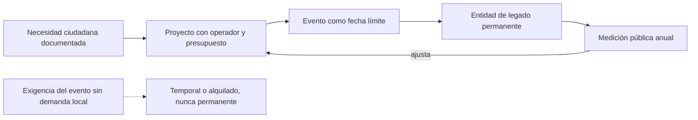

# Análisis por dimensiones

← [Índice](README.md) · Las fuentes de cada dato están en las [fichas por ciudad](02-casos/README.md).

---

## 1. Movilidad
*Transporte público, congestión, aeropuertos, conectividad y desplazamiento de visitantes.*

| Funcionó | No funcionó |
|---|---|
| Atenas: metro, tranvía, tren suburbano y aeropuerto quedaron en uso. | Brasil: solo 6 de 35 proyectos de transporte a tiempo (informe preliminar); VLT de Cuiabá inconcluso. |
| Barcelona: rondas y nuevas conexiones, con inversión posterior en puerto, aeropuerto y alta velocidad. | Río: BRT deteriorado hasta requerir intervención en 2021. |
| Qatar: metro ligado a las sedes. | Sudáfrica: el Gautrain resulta caro para la mayoría. |
| Mundial 2026: la salida de los partidos y la coordinación entre agencias fueron el punto crítico. | |

**Aprendizaje:** la obra es la mitad; **operación, tarifa, mantenimiento y seguridad** son la otra. Un corredor que no se puede sostener se degrada.

**Para Barranquilla:** primero rescatar y rediseñar el sistema existente; cualquier proyecto férreo debe superar factibilidad antes de comprometerse.

---

## 2. Infraestructura y espacio público
*Estadios, escenarios, vías, hoteles, parques, zonas peatonales y accesibilidad.*

| Funcionó | No funcionó |
|---|---|
| Barcelona: zonas verdes y playas +78 %; los escenarios fueron una parte pequeña de la inversión (9,1 %). | Brasil, Sudáfrica: estadios sobredimensionados. |
| París: casi todo existente o temporal. | Atenas, Río: sedes especializadas sin uso. |
| Qatar: estadio desmontable. | Londres: el modelo financiero del estadio generó costos recurrentes. |
| Medellín y Barcelona: escenarios integrados a la trama urbana. | Medellín: gestión que redujo el uso libre. |

**Aprendizaje:** dimensionar para la **demanda ordinaria** y cubrir el pico con estructuras temporales. Hoteles: construirlos solo si la demanda de un año normal los sostiene (Barcelona triplicó capacidad **y** duplicó visitantes).

---

## 3. Economía
*Inversión, empleo, turismo, empresas, deuda y beneficios de largo plazo.*

| Evidencia | Lectura |
|---|---|
| [Baade y Matheson (2016)](https://ideas.repec.org/a/aea/jecper/v30y2016i2p201-18.html): los efectos de corto plazo de los Juegos son casi nulos o una fracción de lo previsto. | No financiar obras con ingresos turísticos supuestos. |
| Oxford 2024: sobrecosto promedio 159 %. | Presupuestar con **reserva** y escenarios de estrés. |
| París: +0,07 puntos de PIB en 2024. | Incluso una buena edición mueve poco la macroeconomía. |
| Barcelona: desempleo 18,4 % → 9,6 %, y +21.000 desempleados tras los Juegos. | El empleo de obra es temporal; el permanente viene de la inversión que sigue. |
| Atenas: peso de la deuda olímpica discutido (2-3 % según Rogge; negado como causa por organizadores). | El evento no explica solo una crisis, pero reduce margen fiscal. |

**Aprendizaje:** separar siempre **costo de organización** (se consume) de **inversión urbana** (permanece), como propone Brunet, y publicar ambos.

---

## 4. Medio ambiente
*Contaminación, residuos, agua, energía, emisiones y sostenibilidad de obras.*

| Funcionó | No funcionó |
|---|---|
| París: saneamiento del Sena; meta de carbono definida antes. | Río: bahía de Guanabara sin cumplir la meta. |
| Barcelona: saneamiento, playas, zonas verdes. | Qatar: afirmación «carbono neutral» considerada engañosa. |
| Alemania 2006: metas medibles (*Green Goal*). | Cifras de huella distintas según método (París: 1,59 frente a 2,085 MtCO₂e). |

**Aprendizaje:** metas verificables, línea base antes de la obra y auditor independiente. Evitar etiquetas de «neutralidad» basadas en compensaciones.

---

## 5. Inclusión social
*Desplazamiento, desigualdad, discapacidad, participación y reparto de beneficios.*

| Caso | Hecho |
|---|---|
| Río | 77.206 personas removidas 2009-2015 (sociedad civil); Vila Autódromo casi desaparecida. |
| París | ~20.000 expulsadas de asentamientos informales (organizaciones; disputado). |
| Londres | 27 % de vivienda asequible frente a meta de 35 %. |
| Medellín | Venteros reubicados sin estudios suficientes; villa convertida en vivienda social. |
| Sudáfrica | Beneficios concentrados en clases medias. |
| Qatar | Graves problemas de derechos de trabajadores migrantes. |

**Aprendizaje:** el desplazamiento no solo viene de la demolición: también del **precio**, de las **restricciones al comercio informal** y de los operativos de «limpieza» del espacio público.

**Vacío de evidencia:** esta investigación obtuvo poca información comparable sobre **accesibilidad para personas con discapacidad**. Es una línea que debe profundizarse; para Barranquilla se propone auditoría propia con organizaciones de personas con discapacidad.

---

## 6. Servicios públicos
*Agua, alcantarillado, energía, telecomunicaciones y saneamiento.*

| Referencia | Aprendizaje |
|---|---|
| Requisitos FIFA 2034: cada estadio exige **dos fuentes de energía independientes**; el centro de transmisión requiere redundancia de energía y telecomunicaciones ([documento](https://images.assettype.com/esakal/2024-12-11/zhas8zsy/FWC2034_Overview_of_Hosting_Requirements_EN.pdf)). | La redundancia del evento no debe quedarse dentro del estadio. |
| Barcelona: alcantarillado +17 %. | El evento puede financiar redes invisibles. |
| Río: saneamiento incumplido. | Las redes se aplazan si no tienen responsable. |
| Mundial 2026: salud y calor requieren más de 18 meses de preparación. | Planear salud pública con años. |

**Vacío de evidencia:** pocos balances posteriores miden agua, energía y telecomunicaciones. Barranquilla debe construir su propia línea base.

---

## 7. Legado urbano
*Qué quedó, qué transformó y qué no dejó beneficios.*

| Transformó | No dejó beneficio duradero (o está en duda) |
|---|---|
| Frente marítimo de Barcelona | Estadios sin demanda (Brasil, Sudáfrica) |
| Transporte de Atenas | Sedes especializadas cerradas (Atenas) |
| Parque y barrio del este de Londres | Obras inconclusas (Cuiabá, Ibagué) |
| Sena nadable en París | Promesas ambientales incumplidas (Río) |
| Villa convertida en vivienda (Medellín) y uso sanitario (Lima) | Sedes cuyo uso depende de una entidad que puede desaparecer |

