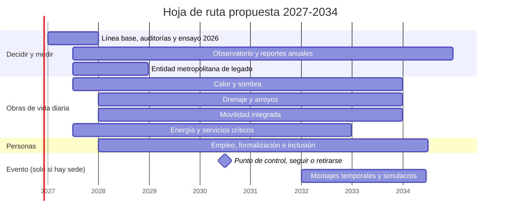

# Barranquilla 2034: las 7 preguntas

← [Índice](README.md) · Datos y fuentes en el [diagnóstico](07-barranquilla-diagnostico.md).

## 1. ¿Qué ventajas tendría para organizar un evento así?
1. Un estadio grande recién ampliado.
2. Experiencia reciente: Juegos Centroamericanos 2018, Mundial Sub-20 2011 y final de la Sudamericana 2026.
3. Identidad futbolera y cultural (Carnaval reconocido por la UNESCO).
4. Ubicación Caribe, aeropuerto y puerto, y ciudades turísticas cercanas.
5. Trayectoria en parques y recuperación de espacios (Malecón, Mallorquín).
6. Capacidad de crédito bien calificada.

**Matiz:** ninguna ventaja suple energía, transporte, calor ni gobernanza.

## 2. ¿Cuáles son las principales debilidades y riesgos?
| Debilidad (hoy) | Riesgo (futuro) |
|---|---|
| Red eléctrica en crisis | Apagones en días de partido y daño reputacional |
| Transmetro con demanda en caída | Congestión e informalidad |
| Calor desigual | Emergencias sanitarias |
| Arroyos | Accesos cortados |
| Informalidad laboral | Exclusión de vendedores |
| Poco espacio público por habitante | Saturación en zonas de fiesta |
| Aeropuerto en obras | Cuello de botella de llegadas |
| Pérdida de 2027 y datos de legado escasos | Falta de credibilidad |

## 3. ¿Qué problemas se agravarían con la llegada masiva?
| Sistema | Presión | Medida preventiva |
|---|---|---|
| Transporte | Picos antes y después del partido | Carriles prioritarios, boleta con transporte incluido, plan de salida |
| Energía | Más aire acondicionado | Respaldo, gestión de demanda, mantenimiento previo |
| Salud | Calor, aglomeraciones | Puestos de hidratación, triage, simulacros |
| Agua y residuos | Más consumo y basura | Puntos de agua, separación, recicladores contratados |
| Vivienda | Alquiler temporal | Registro y límites al alojamiento turístico en zonas presionadas |
| Espacio público | Fiestas y comercio | Zonificación pactada con vendedores |
| Seguridad | Hurto, explotación sexual y laboral, extorsión | Prevención con enfoque de derechos |
| Ambiente | Presión sobre ciénaga, playas y río | Aforos y monitoreo |

## 4. ¿Qué infraestructura y servicios deben fortalecerse?
| Prioridad | Qué | Tipo |
|---|---|---|
| 1 | Redes de distribución y subestaciones; respaldo en servicios críticos | Permanente |
| 2 | Drenaje pluvial y mantenimiento de arroyos | Permanente |
| 3 | Sombra, arbolado, agua potable pública y andenes accesibles | Permanente |
| 4 | Buses integrados, paraderos con sombra, operación financiada | Permanente |
| 5 | Terminal aérea: climatización, migración, equipajes, accesos | Permanente |
| 6 | Red de urgencias y vigilancia en salud | Permanente |
| 7 | Telecomunicaciones redundantes | Permanente + temporal |
| 8 | Estadio: cubierta, energía, accesibilidad, certificación (según auditoría) | Ajuste |
| 9 | Fan zones, graderías, puestos médicos | **Temporal** |
| 10 | Alojamiento adicional | Temporal y regional |

## 5. ¿Qué oportunidades podrían mejorar la calidad de vida?
- **Una ciudad caminable a pleno sol**, empezando donde más calor hace.
- **Menos inundaciones** mediante arroyos convertidos en infraestructura verde.
- **Viajes más cortos y seguros** desde los barrios hasta empleo y estudio.
- **Empleo formal para jóvenes** ligado a obras, operación, turismo y cultura.
- **Deporte cerca de casa**, con las sedes abiertas a escuelas y comunidad.
- **Energía confiable** en colegios, centros de salud y refugios.

## 6. ¿Cómo evitar que las inversiones solo beneficien zonas turísticas o de sedes?
> Todas las reglas siguientes son **propuestas**; los porcentajes deben discutirse y ajustarse con datos.

1. **Mapa de déficit** por barrio (calor, inundación, transporte, parques, pobreza, accesibilidad), público y actualizado.
2. **Regla de reparto:** al menos la mitad de la inversión de legado en las zonas con mayor déficit.
3. **Paquete de barrio:** cada peso en entorno de sedes o corredor turístico arrastra una inversión equivalente definida en barrios priorizados.
4. **Dos fan zones**, una de ellas en el sur o suroccidente.
5. **Rutas alimentadoras** primero donde la gente está a más de 500 m del transporte.
6. **Presupuesto participativo** y veedurías con acceso a contratos.
7. **Compras y empleo local** con cupos para jóvenes, mujeres, personas con discapacidad y recicladores.
8. **No desplazamiento:** censo previo, consulta, mejoramiento en sitio; medir arriendos.
9. **Captura de valor** (participación en plusvalía, Ley 388 de 1997) para reinvertir en vivienda y barrios.

## 7. ¿Qué proyectos deben empezar desde ahora?

| # | Proyecto | Inicio | Resultado verificable | ¿Sirve sin Mundial? |
|---|---|---|---|:-:|
| A | Línea base y observatorio ciudadano de datos | 2027 | Tablero público | ✅ |
| B | Evaluación independiente de la final Sudamericana 2026 | 2027 (T1) | Informe con lecciones | ✅ |
| C | Auditoría de sedes 2018 y estadio | 2027 | Uso, costo y estado por escenario | ✅ |
| D | Plan de acción contra el calor | 2027 | Corredores de sombra y alertas | ✅ |
| E | Plan maestro pluvial con soluciones basadas en la naturaleza | 2027-2028 | Cartera priorizada | ✅ |
| F | Reforma de movilidad metropolitana | 2027-2028 | Red integrada y fuente de operación | ✅ |
| G | Mesa regional-nacional de energía y respaldo crítico | 2027 | Plan de inversión con responsables | ✅ |
| H | Plan de aeropuerto y contingencia regional | 2027 | Capacidad y calendario | ✅ |
| I | Formación para empleo y formalización | 2028 | Personas certificadas y colocadas | ✅ |
| J | Protocolo de vivienda, comercio informal y accesibilidad | 2027 | Norma adoptada | ✅ |
| K | Decisión de candidatura o participación | cuando exista convocatoria | Análisis costo-beneficio y condiciones de salida | — |
| L | Obras temporales del evento | 2032-2034 | Solo si hay sede confirmada | ❌ |

**Calendario político:** en Colombia habrá elecciones locales en 2027 y 2031, y nacionales en 2030 y 2034. La hoja de ruta necesita acuerdos y financiación que sobrevivan a esos relevos.
