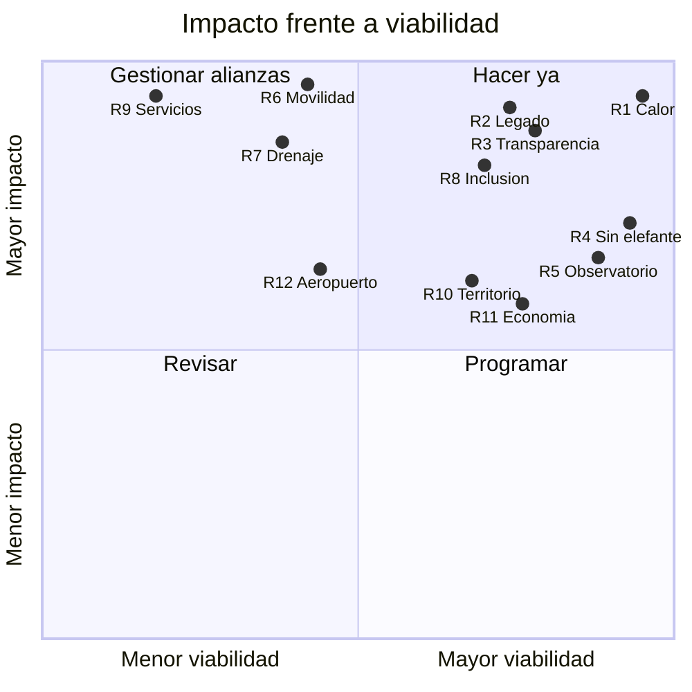

# 12 recomendaciones estratégicas

← [Índice](README.md)

## Método de priorización
Cada recomendación se calificó de 1 a 5 en **impacto** (en la vida de los residentes), **urgencia** y **viabilidad** (técnica, fiscal y política). Total de 3 a 15. Prioridad **A:** 13-15 · **B:** 11-12. Son **juicios del equipo**: conviene que el grupo los vuelva a votar. Las metas son **propuestas**, a calibrar con la línea base.

## Tabla de recomendaciones

| # | Recomendación | Justificación (experiencia real) | Beneficio permanente esperado | Imp. | Urg. | Via. | Total | Prior. |
|---|---|---|---|:-:|:-:|:-:|:-:|:-:|
| 1 | **Plan de calor y sombra**, empezando por occidente y sur | Banco Mundial documenta desigualdad térmica; Mundial 2026 mostró que el calor requiere años de preparación | Menos enfermedad; ciudad caminable | 5 | 5 | 5 | **15** | A |
| 2 | **Entidad metropolitana de legado** y prueba «sin Mundial» | Londres y Lima crearon responsables; Barcelona siguió invirtiendo tras 1992 | Continuidad más allá de un gobierno | 5 | 5 | 4 | **14** | A |
| 3 | **Presupuesto completo, transparencia y condiciones de salida** | Oxford: 159 % de sobrecosto promedio; Ibagué; Colombia 1986 | Menos deuda y corrupción | 5 | 5 | 4 | **14** | A |
| 4 | **Cero elefantes blancos**: auditar, adaptar y alquilar antes de construir | París y Qatar usaron lo temporal; Brasil, Atenas y Sudáfrica no | Gasto en lo que se usa | 4 | 5 | 5 | **14** | A |
| 5 | **Observatorio independiente** y ensayos con eventos reales | Cuentas públicas de Londres; final 2026 como prueba | Decisiones con datos | 4 | 5 | 5 | **14** | A |
| 6 | **Rescatar y rediseñar la movilidad** metropolitana | Río (BRT sin sostenimiento); Brasil (VLT inconcluso); Atenas (legado útil) | Viajes más cortos y asequibles | 5 | 5 | 3 | **13** | A |
| 7 | **Arroyos y drenaje sostenible** con metas auditadas | Barcelona y París recuperaron agua; Río incumplió | Menos inundaciones y más verde | 5 | 5 | 3 | **13** | A |
| 8 | **No desplazamiento, vivienda, comercio informal y accesibilidad** | Río, Londres, París, Medellín | Beneficios sin expulsión | 5 | 4 | 4 | **13** | A |
| 9 | **Energía, agua y residuos confiables** | Crisis de Air-e; requisitos FIFA de redundancia | Servicios todos los días | 5 | 5 | 2 | **12** | B* |
| 10 | **Reparto territorial** de la inversión | Sudáfrica y Río concentraron beneficios | Cierre de brechas | 4 | 3 | 4 | **11** | B |
| 11 | **Economía local, empleo juvenil y turismo todo el año** | Barcelona sostuvo la demanda; París mostró efecto macro modesto | Empleo que queda | 4 | 3 | 4 | **11** | B |
| 12 | **Aeropuerto y conectividad regional** con contingencias | Represamiento aéreo en la final 2026 (atribuido al clima): muestra dependencia de conexiones | Conectividad para comercio y turismo | 4 | 4 | 3 | **11** | B |

\* La 9 queda en B solo por **viabilidad** (depende de regulación y recursos nacionales). Su urgencia es máxima y es condición previa de cualquier candidatura.

## Matriz de acción

## Fichas de implementación

| # | Primeras acciones (12-18 meses) | Indicador y meta propuesta | Responsable sugerido | Costo relativo | Riesgo principal |
|---|---|---|---|:-:|---|
| 1 | Mapa térmico; corredores de sombra a paraderos y colegios; refugios; alertas y horarios | Temperatura y cobertura arbórea por barrio; sombra en 100 % de paraderos prioritarios | Distrito, salud, ambiente | $ | Árboles sin riego ni mantenimiento |
| 2 | Acuerdo metropolitano; junta con academia y comunidad; mandato más allá de 2034 | Entidad creada con presupuesto plurianual | Alcaldías, Gobernación, Concejos | $ | Captura política |
| 3 | Presupuesto total con indirectos y reserva; contratos abiertos; interventoría externa; umbrales de retiro | 100 % de contratos publicados; desviación reportada por trimestre | Hacienda, Contraloría, veedurías | $ | Publicar sin que nadie revise |
| 4 | Inventario de escenarios; plan de operación a 15 años como requisito | Horas de uso comunitario por escenario | Recreación y Deportes | $ | Presión para obra nueva |
| 5 | Línea base; evaluación de la final 2026; tablero anual | Indicadores publicados cada año; auditoría externa | Universidades y observatorios ciudadanos | $ | Falta de datos o independencia |
| 6 | Rediseño de rutas; integración de bus colectivo y masivo; fuente de operación; carriles y andenes accesibles | Demanda, tiempo de viaje, población a menos de 500 m | Autoridad metropolitana de transporte | $$$ | Sin acuerdo con operadores |
| 7 | Plan maestro; limpieza con comunidad y recicladores; retención, jardines de lluvia, pavimento permeable donde sirva | Puntos críticos eliminados; cierres por lluvia | Distrito, Triple A, Corporación Autónoma | $$$ | Canalizar sin retener agua |
| 8 | Censo; protocolo anti desalojo; registro de alquiler turístico; auditoría de accesibilidad con personas con discapacidad | Hogares desplazados (meta: cero involuntarios sin solución); rutas accesibles | Planeación, hábitat, inclusión | $$ | Protocolos sin fuerza legal |
| 9 | Mesa con Gobierno nacional y reguladores; respaldo solar en servicios críticos; plan de pérdidas y reposición | Frecuencia y duración de cortes; continuidad de agua; aprovechamiento de residuos | Nación, operadores, Distrito | $$$ | Reforma nacional estancada |
| 10 | Mapa de déficit; regla de reparto; presupuesto participativo | % de inversión en zonas priorizadas (propuesta: ≥ 50 %) | Planeación, Concejo | $ | Reclasificar gasto para cumplir |
| 11 | Formación con el SENA y universidades; compras locales; calendario anual | Empleo formal juvenil; ocupación hotelera en temporada baja | Desarrollo económico, gremios | $$ | Empleo solo temporal |
| 12 | Cerrar obras pendientes; plan de picos; acuerdos con Cartagena y Santa Marta | Tiempos de proceso; cancelaciones; capacidad en hora pico | Aerocivil, Distrito, aerolíneas | $$ | Cambios de operador |

Costo relativo: **$** bajo · **$$** medio · **$$$** alto. No se asignan cifras porque no existen estudios de costo para estas propuestas.

## Si solo se pudieran hacer tres cosas en 2027
1. **Medir** (línea base, final 2026, sedes de 2018).
2. **Dar sombra y drenaje** donde más se necesita.
3. **Crear la entidad de legado** con reglas de transparencia y salida.
