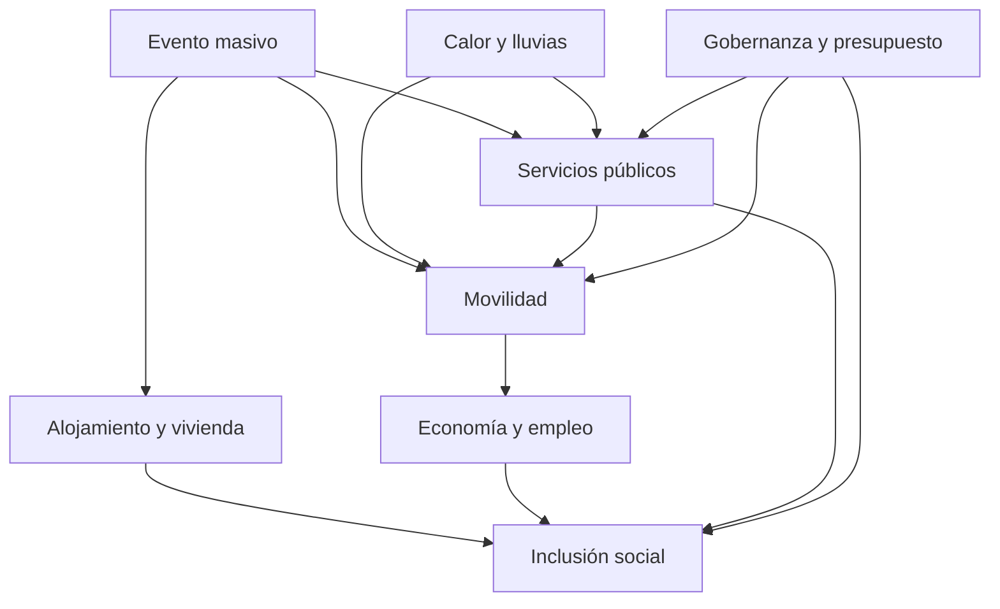

# Introducción y principales hallazgos

← [Índice](README.md)

## El reto
**QUJAM, Bootcamp de Innovación:** en un escenario futuro, Barranquilla es anunciada como sede de un Mundial de Fútbol en 2034. ¿Está preparada para recibir al mundo?

> ⚠️ **Es un escenario hipotético.** En la realidad, el Congreso de la FIFA [adjudicó el Mundial 2034 a Arabia Saudita](https://inside.fifa.com/organisation/congress/media-releases/extraordinary-congress-appoints-hosts-of-2030-and-2034-editions-of-fifa-world-cup) el 11 de diciembre de 2024. Este trabajo usa 2034 como horizonte de planeación.

## Enfoque
Tratamos la ciudad como un **sistema**: movilidad, servicios, espacio público, ambiente, inclusión y economía dependen unos de otros.

## Diez hallazgos

| # | Hallazgo | Dónde profundizar |
|---|---|---|
| 1 | Los sobrecostos son la norma: el estudio de Oxford calcula **159 % de promedio** real en Juegos Olímpicos y ninguna edición con datos disponibles quedó dentro del presupuesto. | [Tabla](03-tabla-comparativa.md) |
| 2 | Los mejores legados nacen de **necesidades previas** (frente marítimo, transporte, un río). | [Aciertos](06-errores-aciertos-y-legado.md) |
| 3 | Los peores combinan **sedes sobredimensionadas** y ausencia de operador. | [Errores](06-errores-aciertos-y-legado.md) |
| 4 | La movilidad prometida es de lo primero que se recorta o se deteriora (Brasil, Río). | [Dimensiones](04-analisis-por-dimensiones.md) |
| 5 | El costo social (desalojos, arriendos, informalidad, trabajo) aparece incluso en ediciones consideradas exitosas. | [Experiencias](05-experiencias-positivas-y-negativas.md) |
| 6 | El efecto económico agregado suele ser **modesto**: París, +0,07 puntos de PIB en 2024. | [París](02-casos/10-paris-2024.md) |
| 7 | La experiencia local importa: Barranquilla **perdió** los Panamericanos 2027 y, antes, Colombia renunció al Mundial 1986. | [Complementarios](02-casos/11-casos-complementarios.md) |
| 8 | Barranquilla tiene activos (estadio ampliado, parques, Mallorquín, cultura, calificación AAA). | [Diagnóstico](07-barranquilla-diagnostico.md) |
| 9 | Sus brechas críticas son **energía, transporte, calor, drenaje y gobernanza de legado**. | [Diagnóstico](07-barranquilla-diagnostico.md) |
| 10 | Un solo partido (final Sudamericana 2026) llenó los hoteles: sirve como **ensayo para medir**, no como prueba de que está lista. | [Complementarios](02-casos/11-casos-complementarios.md) |

## Método
- Investigación documental con búsquedas web, hecha el **26 de noviembre de 2026**.
- 10 casos principales y 7 complementarios.
- Fuentes: FIFA, COI, Banco Mundial, tribunales de cuentas, gobiernos, academia, organizaciones sociales y prensa. El [listado](11-referencias.md) indica cuáles se **leyeron en el original** y cuáles se **citan a partir del resumen de búsqueda**.

## Límites de esta investigación
- No hubo trabajo de campo, entrevistas ni encuestas.
- Varias cifras vienen de prensa o de partes interesadas; se señalan.
- Hay poca evidencia comparable sobre accesibilidad, agua, energía, telecomunicaciones y medio ambiente en varios casos.
- No se obtuvieron informes de BID u ONU-Hábitat con evaluación detallada de estos casos; de ONU-Hábitat se cita una guía general.
- Las calificaciones, semáforos y prioridades son **juicios del equipo**, no mediciones.
