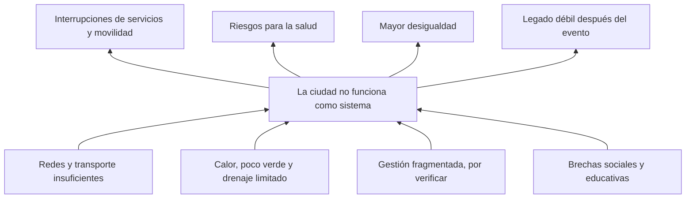
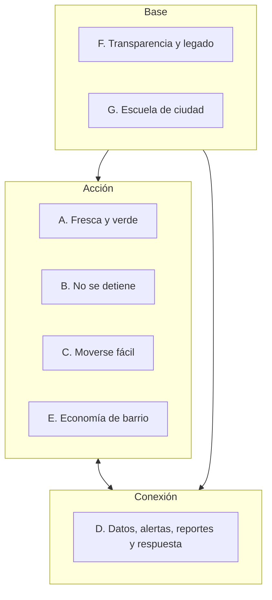

# Sprint 1: Comprender y diseñar

## Barranquilla Lista: primero para su gente

**Bootcamp de Innovación QUIJAM** · Fecha de corte: 26 de noviembre de 2026
**Entregable:** diagnóstico, problema central y arquitectura inicial

> **Escenario ficticio de prospectiva:** imaginamos que Barranquilla es anunciada como sede de un Mundial de Fútbol en 2034.
>
> *«Una Barranquilla lista para recibir al mundo porque primero funciona para su gente».*

## Contenido
1. [Entorno elegido](#1-entorno-elegido)
2. [Diagnóstico](#2-diagnóstico)
3. [Personas y actores](#3-personas-y-actores)
4. [Problema central](#4-problema-central)
5. [Propuesta de valor](#5-propuesta-de-valor)
6. [Objetivos](#6-objetivos)
7. [Arquitectura inicial](#7-arquitectura-inicial)
8. [Mapa de las cinco dimensiones](#8-mapa-de-las-cinco-dimensiones)
9. [Aprendizajes de otras ciudades](#9-aprendizajes-de-otras-ciudades)
10. [Decisiones y pendientes](#10-decisiones-y-pendientes)

---

## 1. Entorno elegido

**Toda Barranquilla**, con intervención prioritaria en puntos críticos.

| Punto crítico | Por qué mirarlo |
|---|---|
| Estadio Metropolitano y alrededores | Concentra la multitud en días de partido |
| Aeropuerto Ernesto Cortissoz | Puerta de llegada, con obras pendientes en la información consultada |
| Centro y Gran Bazar | Comercio informal y alta actividad |
| Barrios del sur y occidente | Mayor coincidencia de calor y vulnerabilidad |
| Zonas de arroyos | Inundaciones y cortes de movilidad |
| Gran Malecón y Ciénaga de Mallorquín | Turismo y presión ambiental |

## 2. Diagnóstico

### Problemas documentados y sus posibles causas

| Problema | Evidencia | Causas |
|---|---|---|
| **Transporte público pierde usuarios** | Transmetro pasó de 29,5 millones de validaciones (2019) a 13,6 millones (2025) ([Olier, 2026](https://gabrielolier.substack.com/p/repensar-la-movilidad-de-barranquilla)) | *Hipótesis:* cobertura incompleta, competencia con otros buses y financiación insuficiente |
| **Energía en crisis** | Air-e intervenida, cartera de más de $6 billones y apagones recurrentes ([Contraloría, vía El Heraldo](https://www.elheraldo.co/atlantico/barranquilla/2026/05/29/contraloria-hace-llamado-urgente-a-superservicios-por-avanzado-deterioro-de-air-e/)) | Incumplimiento de inversiones; la Superservicios la considera [estructural](https://www.eltiempo.com/colombia/barranquilla/desde-barranquilla-superservicios-plantea-que-la-crisis-energetica-del-caribe-es-estructural-y-requiere-un-cambio-de-modelo-y-no-solo-de-operadores-3548236) |
| **Calor desigual** | Superficie de barrios pobres más de 5 °C por encima de los ricos; a mediados de siglo el umbral peligroso de calor y humedad podría superarse tres cuartas partes del año (proyección) ([Banco Mundial](https://documents1.worldbank.org/curated/en/099101025093541356/pdf/P504085-aceef324-8f97-478b-b4cd-6624ef954e6a.pdf)) | Distancia a la brisa marina y desigualdad urbana |
| **Arroyos** | 14.200 toneladas de residuos retiradas de canales y arroyos en 2026 ([El Tiempo](https://www.eltiempo.com/colombia/barranquilla/la-impresionante-cantidad-de-basura-que-termina-en-los-arroyos-de-barranquilla-14-200-toneladas-retiradas-en-2026-y-50-canales-intervenidos-3594947)) | Pérdida de suelo permeable, drenaje insuficiente ([Infobae](https://www.infobae.com/colombia/2026/07/20/asi-evolucionaron-los-famosos-y-peligrosos-arroyos-de-barranquilla-117-personas-fueron-arrastradas-en-el-ultimo-siglo/)) y basura |
| **Poco espacio público** | Cerca de 4 m² por habitante ([El Heraldo](https://www.elheraldo.co/atlantico/2026/05/26/parques-y-zonas-verdes-impulsan-transformacion-urbana-en-barranquilla/)) frente a un mínimo normativo de 15 m² ([Decreto 1077](https://www.cancilleria.gov.co/sites/default/files/Normograma/docs/decreto_1077_2015_pr024.htm)) | *Hipótesis:* crecimiento urbano sin reserva suficiente de suelo |
| **Informalidad laboral** | 52,7 % en 2025 ([Barranquilla Cómo Vamos, vía El Heraldo](https://www.elheraldo.co/atlantico/barranquilla/2026/10/19/la-informalidad-en-barranquilla-cae-a-medida-que-sube-el-nivel-educativo/)) | La informalidad es menor a mayor nivel educativo (relación reportada, no causa única) |
| **Presión sobre Mallorquín** | Calidad de agua baja y arroyo León señalado como fuente ([tesis de Uninorte](https://manglar.uninorte.edu.co/bitstream/handle/10584/13681/14-06-2025-TESIS-MAESTRIA_LOD.pdf?sequence=1), sin verificar en el original) | Vertimientos y residuos |

### Por verificar en campo
- Inundaciones, sombra, andenes y comercio en cada punto crítico.
- Brecha digital por barrio y sistemas de alerta existentes.
- Número de vendedores informales y recicladores.
- Qué entidades coordinan hoy estos problemas.

## 3. Personas y actores

### Población beneficiaria
| Grupo | Qué necesita |
|---|---|
| Habitantes, con prioridad en sur y occidente | Sombra, drenaje, energía y transporte |
| Usuarios del transporte público | Viajes accesibles, seguros e informados |
| Personas con discapacidad y adultos mayores | Recorridos sin barreras |
| Vendedores, recicladores y emprendedores | Participar en la economía del evento |
| Niños y jóvenes | Educación, liderazgo y empleo |
| Visitantes | Orientación, movilidad y atención |

### Actores propuestos
Aún no se ha contactado a ninguno.

| Actor | Papel posible |
|---|---|
| Alcaldía, Gobernación y municipios metropolitanos | Coordinar, financiar y ejecutar |
| Gobierno nacional | Energía, aeropuerto y garantías |
| Transmetro y transportadores | Movilidad integrada |
| Operadores de energía, agua y aseo | Continuidad de servicios |
| Concejo y entidades de control | Aprobación y vigilancia |
| Colegios, SENA y universidades | Formación, datos e innovación |
| Gremios y empresas | Empleo y alianzas |
| Juntas de acción comunal y organizaciones | Priorizar, participar y vigilar |

### Quién podría verse afectado
- Vendedores desplazados por zonas comerciales exclusivas del evento.
- Residentes cercanos a las obras.
- Hogares afectados por el alza de arriendos.

## 4. Problema central

> Barranquilla no está preparada para funcionar como un sistema ante la llegada masiva de visitantes. El transporte público pierde usuarios, la red eléctrica está en crisis, los arroyos interrumpen la movilidad, el calor golpea más a los barrios vulnerables y el espacio público es escaso. Estos problemas ya afectan a sus habitantes y un Mundial los intensificaría. Además, sus causas se tratan por separado, sin información compartida ni un responsable que asegure resultados más allá de cada gobierno o evento. Si la inversión se concentra solo en el estadio y las zonas turísticas, el Mundial podría ampliar las desigualdades en lugar de dejar un legado.

La falta de coordinación, de información compartida y de un responsable es una **hipótesis del equipo** que debe verificarse.

### Árbol de causas y efectos

## 5. Propuesta de valor

| | Propuesta | Qué cambia | Para quién |
|---|---|---|---|
| A | **Ciudad fresca y verde** | Rutas con sombra, agua y descanso; arbolado y protección de Mallorquín | Peatones, adultos mayores, trabajadores, comunidades y visitantes |
| B | **Ciudad que no se detiene** | Drenaje sostenible, menos basura, alertas y respaldo de energía en servicios críticos | Barrios inundables, usuarios de servicios críticos y quienes se desplazan |
| C | **Moverse fácil y accesible** | Transporte integrado, andenes continuos e información de rutas | Usuarios del transporte y personas con discapacidad |
| D | **Ciudad que avisa y responde** | Datos de calor, lluvia, energía y movilidad, con reportes ciudadanos y respuesta | Residentes y autoridades |
| E | **El Mundial también vende en el barrio** | Vendedores, jóvenes y cultura local dentro de la economía del evento | Economía popular y emprendedores |
| F | **Legado que se vigila** | Presupuesto abierto, veedurías y un responsable permanente | Toda la ciudadanía |
| G | **Escuela de ciudad: Generación 2034** | Conciencia social y capacidades a largo plazo | Niños, jóvenes, docentes, familias, vendedores y comunidades |

## 6. Objetivos

### Objetivo general
> Preparar a Barranquilla para 2034 como una ciudad conectada, resiliente e incluyente, capaz de recibir al mundo y de mejorar primero la vida de sus habitantes, con prioridad en los puntos críticos.

### Objetivos específicos

| | Objetivo |
|---|---|
| A | Reducir la exposición al calor en recorridos y barrios vulnerables, ampliar el arbolado y proteger la Ciénaga de Mallorquín. |
| B | Disminuir las afectaciones por arroyos con drenaje sostenible, manejo de residuos y alertas, y asegurar respaldo de energía en servicios críticos. |
| C | Mejorar la conexión entre barrios, aeropuerto, estadio y zonas de actividad con transporte integrado y accesible. |
| D | Integrar datos y reportes ciudadanos para anticipar problemas y responder a tiempo. |
| E | Vincular a vendedores, jóvenes y cultura local a las oportunidades antes, durante y después del evento. |
| F | Asegurar transparencia, participación y un responsable del legado más allá de 2034. |
| G | Fortalecer la conciencia social y las capacidades de la ciudadanía mediante un proceso educativo continuo que comience en 2027 y siga después de 2034. |

## 7. Arquitectura inicial

**Transformación común:** una ciudad que funcione como sistema, reciba al mundo y mejore la vida de sus habitantes.

### Componentes y conexiones

| Componente | Función | Entrega | Necesita | Actores propuestos |
|---|---|---|---|---|
| **A** | Reducir calor y cuidar ecosistemas | Rutas con sombra, agua y zonas verdes | Datos de calor y cuidado vecinal | Alcaldía, salud, autoridad ambiental, comunidades |
| **B** | Mantener la ciudad en funcionamiento | Drenaje, menos residuos y respaldo de energía | Alertas y hábitos de cuidado | Alcaldía, operadores de energía, agua y aseo, recicladores |
| **C** | Conectar con accesibilidad | Rutas y andenes accesibles | Avisos y datos de demanda | Transmetro, transportadores, personas con discapacidad |
| **D** | Anticipar y responder | Alertas e información | Reportes, sensores y equipos de respuesta | Distrito, Gobernación, universidades |
| **E** | Incluir la economía popular | Empleo y puntos de venta | Capacitación y espacios acordados | Vendedores, emprendedores, gremios |
| **F** | Vigilar y sostener | Presupuesto abierto y seguimiento | Datos y veedores formados | Concejo, entidades de control, ciudadanía |
| **G** | Formar conciencia y capacidades | Líderes, cursos y proyectos | Docentes, espacios y financiación | Colegios, SENA, universidades, juntas de barrio |

### G. Escuela de ciudad: Generación 2034

| Línea | Qué incluye |
|---|---|
| En los colegios | Cada colegio estudia un problema de su barrio y desarrolla un proyecto |
| Conciencia social | Agua y arroyos, respeto, inclusión, accesibilidad y convivencia |
| Jóvenes líderes | Mentorías, voluntariado y semilleros de tecnología e innovación |
| Formación para el trabajo | Idiomas, turismo, servicios digitales y emprendimiento |
| Cursos cortos | Formación abierta para toda la ciudadanía |

| Curso corto | Dirigido a | Duración sugerida | Resultado práctico |
|---|---|:-:|---|
| Cuidar los arroyos | Vecinos y comerciantes | 6 h | Plan de manejo de residuos de la cuadra |
| Convivencia ciudadana | Toda la comunidad | 4 h | Acuerdo de barrio |
| Inclusión y accesibilidad | Transportadores, hoteles, vendedores y funcionarios | 6 h | Recorrido para identificar barreras |
| Calor y primeros auxilios | Líderes, familias y vendedores | 8 h | Reconocer una emergencia y actuar |
| Prevención de explotación y trata | Hoteles, transporte, jóvenes y familias | 4 h | Identificar señales y saber a quién reportar |
| Anfitriones de ciudad | Jóvenes y personas que atienden visitantes | 8 h | Atención respetuosa y turismo responsable |
| Veeduría ciudadana | Jóvenes y organizaciones de barrio | 8 h | Seguimiento a un compromiso público |

- **Modalidad:** colegios, espacios comunitarios y en línea; noches y fines de semana para quienes trabajan.
- **Acceso:** gratuito, comenzando en los puntos críticos, con certificado.
- **Multiplicadores:** quienes lo deseen se forman para enseñar en su barrio.
- **Medición:** conocimientos antes y después, y acciones realizadas semanas más tarde.

| Etapa | Enfoque |
|---|---|
| 2027-2028 | Diagnóstico y prueba piloto en barrios críticos |
| 2029-2033 | Ampliación a toda la ciudad |
| 2034 | Participación de jóvenes y comunidades en el evento |
| 2035 en adelante | Programa permanente |

### Puntos críticos
● intervención principal · ○ apoyo

| Punto | A | B | C | D | E | F | G |
|---|:-:|:-:|:-:|:-:|:-:|:-:|:-:|
| Metropolitano | ● | ○ | ● | ● | ● | ○ | ○ |
| Aeropuerto | ○ | ○ | ● | ● | ○ | ○ | ○ |
| Centro y Gran Bazar | ● | ○ | ● | ○ | ● | ○ | ● |
| Sur y occidente | ● | ● | ● | ○ | ○ | ● | ● |
| Zonas de arroyos | ○ | ● | ○ | ● | ○ | ○ | ● |
| Malecón y Mallorquín | ● | ● | ○ | ○ | ● | ○ | ● |

### Ejemplo de funcionamiento
Llueve antes de un partido: **D** emite la alerta, **B** atiende el punto afectado, **C** desvía las rutas, los líderes formados en **G** orientan al barrio y **F** registra si se respondió a tiempo.

## 8. Mapa de las cinco dimensiones
● aporte principal · ○ aporte de apoyo

| Componente | Ciudad y territorio | Sostenibilidad | Ciudad inteligente | Ciudadanía | Economía y oportunidades |
|---|:-:|:-:|:-:|:-:|:-:|
| A | ● | ● | ○ | ○ | ○ |
| B | ● | ● | ○ | ○ | ○ |
| C | ● | ○ | ○ | ○ | ○ |
| D | ○ | ○ | ● | ○ | ○ |
| E | ○ | ○ | ○ | ● | ● |
| F | ○ | ○ | ○ | ● | ○ |
| G | ○ | ○ | ○ | ● | ● |

## 9. Aprendizajes de otras ciudades

| Experiencia | Qué tomamos o evitamos | Componente |
|---|---|:-:|
| [Barcelona 1992](https://github.com/dagoregino/Andromeda/blob/docs/investigacion-barranquilla-2034/investigacion/02-casos/01-barcelona-1992.md) | Plan de ciudad primero, evento después | F |
| [Londres 2012](https://github.com/dagoregino/Andromeda/blob/docs/investigacion-barranquilla-2034/investigacion/02-casos/05-londres-2012.md) | Responsable del legado y metas sociales exigibles | F |
| [París 2024](https://github.com/dagoregino/Andromeda/blob/docs/investigacion-barranquilla-2034/investigacion/02-casos/10-paris-2024.md) | Reutilizar y recuperar un cuerpo de agua visible | A |
| [Medellín 2010](https://github.com/dagoregino/Andromeda/blob/docs/investigacion-barranquilla-2034/investigacion/02-casos/04-medellin-2010.md) | Censar y pactar con vendedores antes de intervenir | E |
| [Brasil 2014](https://github.com/dagoregino/Andromeda/blob/docs/investigacion-barranquilla-2034/investigacion/02-casos/06-brasil-2014.md) | No prometer transporte sin proyectos maduros | C |
| [Río 2016](https://github.com/dagoregino/Andromeda/blob/docs/investigacion-barranquilla-2034/investigacion/02-casos/07-rio-2016.md) | No incumplir saneamiento ni desplazar comunidades | B, F |
| [Sudáfrica 2010](https://github.com/dagoregino/Andromeda/blob/docs/investigacion-barranquilla-2034/investigacion/12-dimensiones-complementarias.md) | Negociar las zonas comerciales antes de firmar | E |
| [Barranquilla 2027](https://github.com/dagoregino/Andromeda/blob/docs/investigacion-barranquilla-2034/investigacion/02-casos/11-casos-complementarios.md) | Cumplir compromisos con garantías de todos los gobiernos | F |

La investigación completa está en la rama [`docs/investigacion-barranquilla-2034`](https://github.com/dagoregino/Andromeda/tree/docs/investigacion-barranquilla-2034/investigacion).

## 10. Decisiones y pendientes

### Decisiones del equipo
- El entorno es toda la ciudad, con puntos críticos.
- Se aprobaron las propuestas de valor y se sumó la Escuela de ciudad con cursos cortos.
- Se aprobó la arquitectura, ampliando A (verde y Mallorquín) y B (energía).

### Pendientes
- Verificar en campo las hipótesis del diagnóstico.
- Abrir las fuentes antes de presentar cifras.
- Confirmar con la organización si se exige prototipo físico, digital o ambos.
- Asignar roles: coordinación, investigación, diseño, prototipado y comunicación.

### Paso al Sprint 2
Programa estructurado, prototipo inicial, funcionamiento, recursos, alianzas, indicadores y hoja de ruta preliminar.
